# Топ-20 фильмов по пользовательским оценкам

## Для кого и зачем

Функция предназначена для пользователя, который хочет быстро увидеть свои самые высоко оценённые фильмы. Она позволяет выставлять личную оценку от 1 до 5 звёзд и автоматически формирует рейтинг из не более чем 20 фильмов.

## Что должно быть

- Пользователь может выставить фильму оценку от 1 до 5 звёзд.
- Оценку можно изменить или удалить.
- Текущая оценка отображается в карточке фильма в формате от 1 до 5 заполненных звёзд: `★`, `★★`, `★★★`, `★★★★` или `★★★★★`.
- Если оценка отсутствует, в карточке отображается текст «Не оценено».
- На странице есть отдельный раздел «Топ-20 фильмов».
- В топ попадают только записи с типом «Фильм», которым пользователь поставил оценку.
- Сериалы и фильмы без оценки в топ не попадают.
- Фильмы располагаются по убыванию оценки: сначала 5 звёзд, затем 4 и так далее.
- При одинаковой оценке выше располагается фильм, чья оценка была изменена позднее.
- Если оценка и время её изменения совпадают, фильмы располагаются по названию в алфавитном порядке.
- В топе отображается не более 20 фильмов.
- Для каждой позиции отображаются место, название и оценка звёздами.
- Топ обновляется сразу после выставления, изменения или удаления оценки без перезагрузки страницы.
- Оценки и сформированный порядок сохраняются после обновления страницы через `localStorage`.
- Если оценённых фильмов нет, вместо списка отображается короткое сообщение «Оцените фильмы — здесь появится ваш топ».

## Примеры

### Формирование топа

В коллекции есть:

- фильм «Интерстеллар» — `★★★★★`;
- фильм «Дюна» — `★★★★`;
- фильм «Начало» — `★★★★★`;
- сериал «Разделение» — `★★★★★`;
- фильм «Матрица» — «Не оценено».

Пользователь позднее оценил «Начало», чем «Интерстеллар». В топе отображаются:

1. «Начало» — `★★★★★`;
2. «Интерстеллар» — `★★★★★`;
3. «Дюна» — `★★★★`.

Сериал «Разделение» и неоценённый фильм «Матрица» не отображаются.

### Изменение оценки

Пользователь меняет оценку фильма «Дюна» с `★★★★` на `★★★★★`. «Дюна» сразу перемещается в группу фильмов с пятью звёздами и становится выше фильмов, чьи оценки были изменены раньше.

### Удаление оценки

Пользователь удаляет оценку фильма «Начало». В карточке появляется статус «Не оценено», а фильм сразу исчезает из топа.

### Ограничение списка

Пользователь оценил 24 фильма. В разделе показываются только первые 20 фильмов по правилам сортировки; остальные фильмы остаются в коллекции со своими оценками.

### Пример заполненного топ-20 с постерами

Ниже приведён демонстрационный набор по снимку рейтинга IMDb Top 250 от 22 ноября 2026 года. Исходная оценка IMDb указана для справки, а в интерфейсе проекта она показана по шкале от 1 до 5 звёзд с округлением исходной оценки, делённой на два. Порядок и значения со временем могут измениться.

| Место | Постер | Фильм | IMDb | Оценка в проекте |
| ---: | :---: | --- | :---: | :---: |
| 1 | 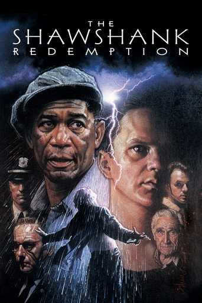 | Побег из Шоушенка (1994) | 9,3 | `★★★★★` |
| 2 | 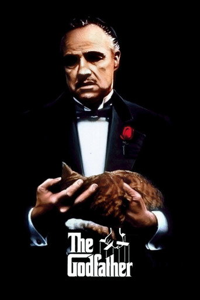 | Крёстный отец (1972) | 9,2 | `★★★★★` |
| 3 | 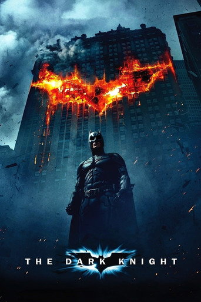 | Тёмный рыцарь (2008) | 9,1 | `★★★★★` |
| 4 | 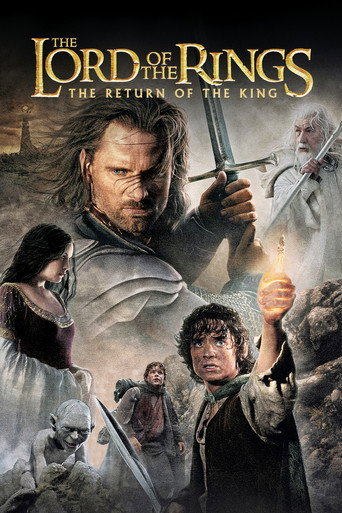 | Властелин колец: Возвращение короля (2003) | 9,0 | `★★★★★` |
| 5 | 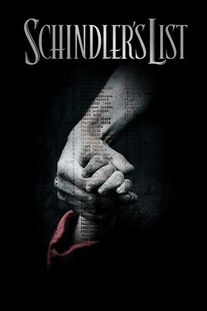 | Список Шиндлера (1993) | 9,0 | `★★★★★` |
| 6 | 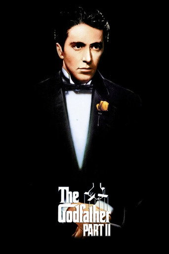 | Крёстный отец 2 (1974) | 9,0 | `★★★★★` |
| 7 | 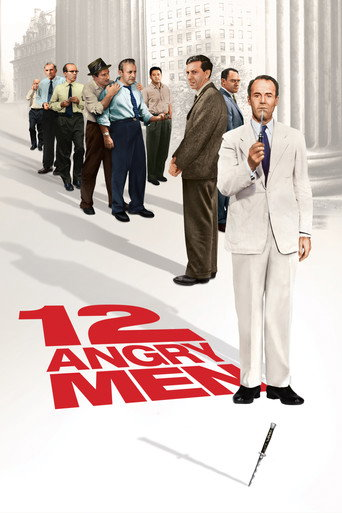 | 12 разгневанных мужчин (1957) | 9,0 | `★★★★★` |
| 8 | 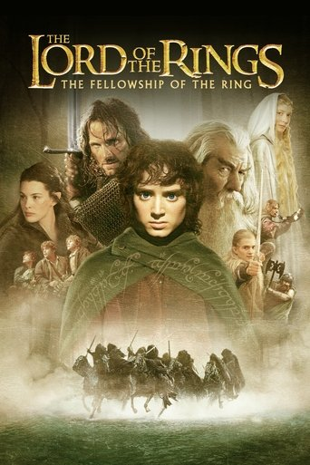 | Властелин колец: Братство Кольца (2001) | 8,9 | `★★★★` |
| 9 | 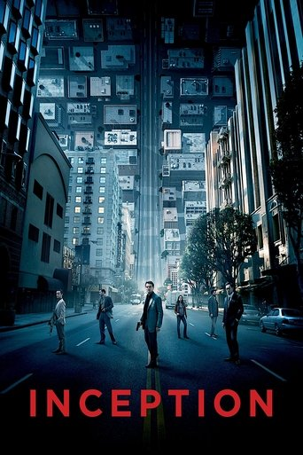 | Начало (2010) | 8,8 | `★★★★` |
| 10 |  | Бойцовский клуб (1999) | 8,8 | `★★★★` |
| 11 |  | Форрест Гамп (1994) | 8,8 | `★★★★` |
| 12 | 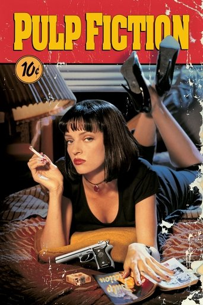 | Криминальное чтиво (1994) | 8,8 | `★★★★` |
| 13 | 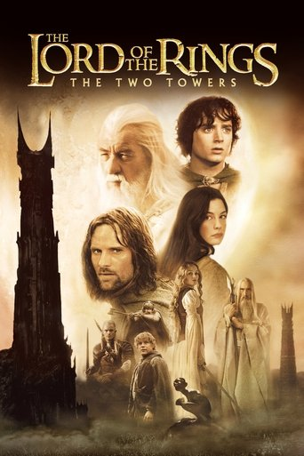 | Властелин колец: Две крепости (2002) | 8,8 | `★★★★` |
| 14 | 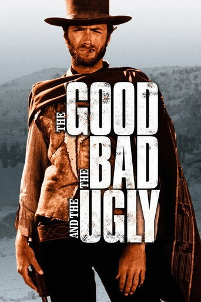 | Хороший, плохой, злой (1966) | 8,8 | `★★★★` |
| 15 | 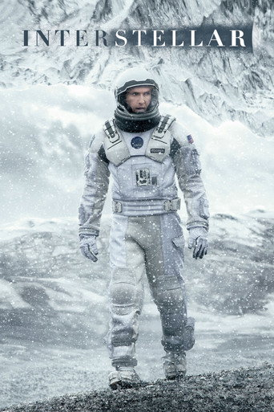 | Интерстеллар (2014) | 8,7 | `★★★★` |
| 16 | 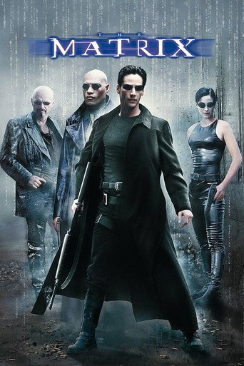 | Матрица (1999) | 8,7 | `★★★★` |
| 17 | 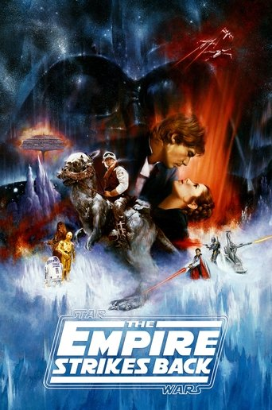 | Звёздные войны: Империя наносит ответный удар (1980) | 8,7 | `★★★★` |
| 18 | 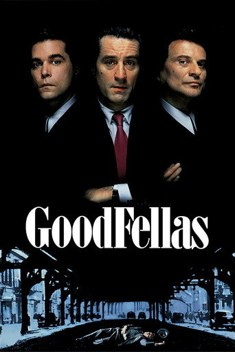 | Славные парни (1990) | 8,7 | `★★★★` |
| 19 | 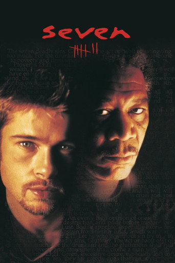 | Семь (1995) | 8,6 | `★★★★` |
| 20 |  | Молчание ягнят (1991) | 8,6 | `★★★★` |

Источник оценок и порядка: [IMDb Top 250](https://www.imdb.com/chart/top/) и [снимок данных за 22 ноября 2026 года](https://4kmonitor.org/en/imdb-top-250). Постеры нужны только для наглядности примера в спецификации и не задают обязательный набор фильмов для пользователя.

## Ограничения

- Допустимы только целые оценки: 1, 2, 3, 4 или 5.
- У одной записи может быть только одна текущая пользовательская оценка.
- Рейтинг строится только по локальным данным пользователя; внешние рейтинги и интернет-запросы не используются.
- В топе учитывается каждая отдельная запись, даже если в коллекции есть фильмы с одинаковыми названиями.
- Изменение оценки не меняет статус просмотра фильма.
- Функция не добавляет отзывы, половины звезды, среднюю оценку или оценки нескольких пользователей.
- Элементы управления оценкой должны быть доступны с клавиатуры и иметь понятные подписи для экранного диктора.
- Интерактивные элементы должны быть не меньше 44px, а раздел должен корректно работать на экране шириной 375px.

## Шаги

### Шаг 1. Оценка фильма

Добавить в карточку фильма управление оценкой от 1 до 5 звёзд, возможность изменить или удалить оценку и подпись «Не оценено» для фильма без оценки.

Проверка:

1. Открыть страницу и поставить любому фильму `★★★★★` — эта оценка появилась в карточке.
2. Изменить оценку на `★★★` — карточка сразу показывает три звезды.
3. Удалить оценку — в карточке появился текст «Не оценено».

### Шаг 2. Формирование топа

Добавить раздел «Топ-20 фильмов», включать в него только оценённые фильмы и сортировать их по заданным правилам.

Проверка:

1. Поставить двум фильмам разные оценки, а сериалу — `★★★★★`.
2. Убедиться, что в топе есть только два фильма и выше расположен фильм с большей оценкой.
3. Изменить оценку нижнего фильма на более высокую — он сразу поднялся выше.

### Шаг 3. Сохранение и мобильный вид

Сохранять оценки в `localStorage` и обеспечить удобную работу раздела и управления оценками на телефоне.

Проверка:

1. Обновить страницу клавишей F5 — оценки и порядок топа не изменились.
2. Открыть страницу при ширине 375px — топ помещается по ширине, текст и кнопки не обрезаны.
3. Перейти к звёздам клавишей Tab и изменить оценку с клавиатуры — оценка и топ обновились.

## Готово, когда

- Фильму можно поставить любую целую оценку от 1 до 5 звёзд.
- Оценку можно изменить и удалить.
- Карточка показывает оценку звёздами или текст «Не оценено».
- В топ попадают только оценённые фильмы, но не сериалы.
- Фильмы отсортированы по оценке, времени изменения оценки и названию по заданным правилам.
- В топе отображается не более 20 позиций с местом, названием и оценкой.
- Изменение или удаление оценки сразу обновляет топ.
- При отсутствии оценённых фильмов отображается предусмотренное пустое состояние.
- После F5 оценки и тот же порядок топа сохраняются.
- Управление оценкой проверено с клавиатуры, а интерфейс проверен при ширине 375px.
